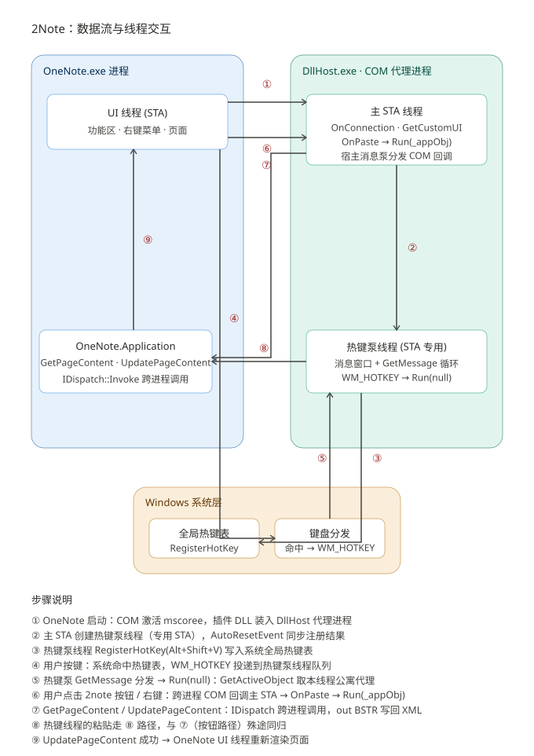

# MD2OneNote 技术原理

> 本文档描述插件当前的最终架构与关键技术决策，每一条都有实测证据支撑（详见《开发探索历史》）。

## 1. 总体架构

```
┌─────────────┐  注册 Alt+V          ┌──────────────────────────────┐
│ message-only │◄────────────────────│  DllHost.exe (COM 代理进程)   │
│ 隐藏窗口      │   WM_HOTKEY         │  MD2OneNote.Addin.dll         │
└─────────────┘                      │  ├─ Connect (IDTExtensibility2│
                                     │  │   + IRibbonExtensibility)  │
OneNote.exe ──COM 回调(onAction)────►│  ├─ PasteEngine (解析+生成)    │
            ◄────────────────────────│  ├─ Dispatch (raw IDispatch)  │
  2note 选项卡 / 右键菜单按钮          │  └─ HotkeyConfig              │
                                     └──────────────┬───────────────┘
                                                    │ raw IDispatch
                                                    ▼
                                     OneNote.Application (out-of-proc)
                                     GetPageContent/UpdatePageContent
```

**运行位置**：加载项通过 mscoree 加载进 **DllHost COM 代理进程**（不是 OneNote 进程内）。这是实测事实——代理进程崩溃（堆损坏）时 OneNote 只表现为回调超时「卡几秒」，DLL 不被 OneNote.EXE 锁定、可随时热替换。好处：插件崩溃不影响 OneNote。

**组件职责**：

| 组件 | 职责 |
|---|---|
| `Connect` | COM 入口：OnConnection 存 Application 对象、GetCustomUI 返回 Ribbon XML、OnPaste/onAction 回调 |
| `PasteEngine` | 读剪贴板 → 解析 HTML/Markdown → 生成 one:XML → UpdatePageContent 写入 |
| `Dispatch` | 手写 raw IDispatch 晚绑定调用器（GetIDsOfNames + Invoke + out 参数管理） |
| `OneNoteApp` | OneNote API 包装（晚绑定）：Windows→CurrentWindow→CurrentPageId、GetPageContent、UpdatePageContent |
| `RawClipboard` | Win32 原生剪贴板读取（'HTML Format' 注册格式 + CF_UNICODETEXT） |
| `HotkeyWindow` | RegisterHotKey + message-only 窗口（无 WinForms 依赖） |
| `HotkeyConfig` | hotkey.txt 解析（组合键 → MOD_* / VK 码） |

### 1.1 线程数据流图



**步骤说明**（与图中编号对应）：

1. OneNote 启动：COM 激活 mscoree，插件 DLL 装入 DllHost 代理进程
2. 主 STA 创建**热键泵线程**（专用 STA），AutoResetEvent 同步注册结果
3. 热键泵线程 `RegisterHotKey(Alt+Shift+V)` 写入系统全局热键表
4. 用户按键：系统命中热键表，WM_HOTKEY 投递到热键泵线程队列
5. 热键泵 GetMessage 分发 → `Run(null)`：GetActiveObject 取本线程公寓代理
6. 用户点击 2note 按钮 / 右键：跨进程 COM 回调主 STA → OnPaste → `Run(_appObj)`
7. GetPageContent / UpdatePageContent：IDispatch 跨进程调用，out BSTR 写回 XML
8. 热键线程的粘贴走 ⑧ 路径，与 ⑦（按钮路径）殊途同归
9. UpdatePageContent 成功 → OneNote UI 线程重新渲染页面

**两条路径为什么分叉**：COM 对象绑定创建它的 STA 单元。`_appObj` 是主 STA 上创建的 RCW，热键泵线程直接用会跨公寓违规；反之热键线程的对象主 STA 也不能碰。所以热键路径在**自己的线程**里通过 `GetActiveObject` 从 ROT 取一个本公寓代理——两条路径各自持有合法代理，最终汇入同一个 COM 服务器。

**历史教训**（线程相关）：v1 的热键窗口建在宿主 STA 线程上但没有任何线程跑消息泵，WM_HOTKEY 永远无人分发——全局热键从 v1 起就没真正工作过，直到 2026-11-06 重构为「专用线程 + 自建消息泵」。

## 2. 为什么绕过 HTML 导入器（核心设计）

OneNote 处理粘贴 HTML 的路径是：HTML → 内置导入器 → 页面 XML。实测结论：

- 只认「真嵌套 `<ul>` + 内联样式」，丢弃 `<style>` 块和 class；
- 靠 CSS（padding-left）实现的缩进被**压平**；
- 凡是走剪贴板/`<HTMLBlock>` 的方案（含 OneMore 的 Convert Markdown）都过这一条路，全军覆没。

**对策**：跳过导入器，直接生成 OneNote 原生 XML：

```xml
<one:Outline>
  <one:Position x="…" y="…"/><one:Size width="620.0" height="…"/>
  <one:OEChildren>
    <one:OE>
      <one:List><one:Bullet bullet="2"/></one:List>   <!-- 列表项 -->
      <one:T><![CDATA[文本（含 <b>/<i>/<a> 内联）]]></one:T>
      <one:OEChildren>…嵌套层级…</one:OEChildren>
    </one:OE>
  </one:OEChildren>
</one:Outline>
```

然后以「整页替换」方式提交：`GetPageContent(当前页)` → 在返回 XML 里追加/构造新 Outline → `UpdatePageContent(新 XML)`。

**插入定位算法**：从页面 XML 找 `selected="all|partial"` 的锚点 OE → 回溯其 Outline 的 `Position x,y` 与 `Size height` → 新容器 y = 锚点 y + height + 15；随后与同列（x 差 <80）其他容器做碰撞下推循环（最多 50 轮），防叠罗汉。找不到选区时追加到 `</one:Page>` 前。高度按 `条目数 × 22 + 20` 估算（OneNote 会按内容自动收缩宽度）。

## 3. 剪贴板读取（CF_HTML 规范处理）

```csharp
uint fmt = RegisterClipboardFormatW("HTML Format");   // Chromium/Office 通用
IntPtr h = GetClipboardData(fmt);
int len = (int)GlobalSize(h);                          // ⚠ SIZE_T 是返回值！
byte[] data = new byte[len]; Marshal.Copy(GlobalLock(h), data, 0, len);
string html = Encoding.UTF8.GetString(data);           // CF_HTML 按规范是 UTF-8 字节流
```

三个致命细节（全部踩过）：
1. **GlobalSize 是返回值**，声明成 out 参数永远得 0（曾导致 HTML 数据被当空、格式全丢）；
2. DataObject.SetData 写入时按 UTF-16 编码，与 CF_HTML 的 UTF-8+字节偏移头不符——必须 GlobalAlloc + 字节写入；
3. 无 'HTML Format' 时回退 CF_UNICODETEXT 按 Markdown 解析。

## 4. OneNote COM 调用：纯晚绑定（关键决策）

### 4.1 为什么不用官方 PIA

- OneNote 的 `IApplication` 在真实类型库里是 **TKIND_DISPATCH 纯 dispinterface**，真实 IID `{452AC71A-B655-4967-A208-A4CC39DD7949}`；PIA 声明的 `{A47D3223-…}` 在进程内 **QueryInterface 永远 E_NOINTERFACE**（addin.log 实测两次）。
- 本机类型库注册表曾多处损坏（详见历史文档），raw 路线不依赖类型库注册，反而最稳。

### 4.2 Dispatch 调用器实现要点

```
GetIDsOfNames(name) → dispid（缓存）
构造 DISPPARAMS：rgvarg[0] = 最后一个参数（倒序）
[out] BSTR 参数：VARIANT vt = VT_BYREF|VT_BSTR(0x4008)，data 指向 BSTR* 槽
Invoke(dispId, …, wFlags=1 或 3)
读回：槽内最终 BSTR → PtrToStringBSTR → OutParam.Value
```

- 签名来自对 `ONENOTE.EXE\3` 内嵌类型库的 FUNCDESC 逐字节解析：`GetHierarchy`/`GetPageContent`/`UpdatePageContent` 均 4 参且 `cParamsOpt=0`（可选参数也必须显式传）。枚举值：hsPages=4、piSelection=2、xs2013=2。
- **[out] BSTR 所有权规则（防堆损坏）**：跨进程时 oleaut 代理写回 [out] 值可能先 `SysFreeString` 调用方传入的原始 BSTR再放入新串。因此**每个 out 槽只释放最终指针一次**——绝不预登记、绝不 double free。违反此规则的直接后果是 DllHost 0xc0000374 堆损坏崩溃（已踩）。
- 入参 VARIANT 里的 BSTR/COM 引用在 finally 里 `CleanupVariant` 显式释放，防泄漏。
- 保留 ITypeInfo 双候选回退（GetTypeInfo(0,0) / LoadTypeLibEx(`<OneNote.exe>\3`)），raw 失败或 out 未写入时自动切换并全程留日志。

### 4.3 当前页获取

`Windows → CurrentWindow → CurrentPageId` 属性链（dispid 0x64 / 0x3 / 0x1，0 参 PROPERTYGET，wFlags=2）；层级 XML `isCurrentlyViewed="true"` 兜底。

## 5. COM 加载项注册与生命周期

- **IDTExtensibility2**（IID `B65AD801-ABAF-11D0-BB8B-00A0C90F2744`）：必须用 no-PIA `[TypeIdentifier]` 等效声明 + **参数级 MarshalAs**：
  - `object` 参数 → `[In, MarshalAs(UnmanagedType.IDispatch)]`（真实接口传裸 IDispatch*，8 字节；缺省编组为 24 字节 VARIANT → x64 上 CLR 桩错位读栈 → AV / InvalidOleVariantTypeException，OneNote 显示「运行时错误」）
  - `ref Array custom` → `[In, MarshalAs(UnmanagedType.SafeArray, SafeArraySubType=VT_VARIANT)]`
  - vtable 顺序：OnConnection → OnDisconnection → OnAddInsUpdate → OnStartupComplete → OnBeginShutdown（ksaddndr.dll 类型库槽 56/64/72/80/88 + OneMore 双重证实）
- **IRibbonExtensibility**（IID `000C0396-…`）：`GetCustomUI("Microsoft.OneNote")` 返回 2009/07 customUI XML。**结构必须镜像 OneMore 的可用形态**：root 带 `onLoad` 回调 + `<ribbon>` 内**真实 tab**（空 `<tabs/>` 会导致整个 XML 被拒、右键菜单不出现）+ `<contextMenus idMso="ContextMenuPageArea">` 锚点 `insertBeforeMso="RenamePageOneNote"`。
- **注册**：HKLM `CLSID\{4A9D4FBD-…}\InprocServer32` = mscoree.dll + Assembly/Class/CodeBase；HKCU `Office\OneNote\AddIns\MD2OneNote.Connect` LoadBehavior=3。mscoree 激活时把类装进 DllHost 代理（`/Processid:{4A9D4FBD…}`）。
- **热替换**：OneNote.EXE 不锁 DLL（只有临时代理锁），覆盖 DLL 后重启 OneNote 即加载新版。

## 6. 快捷键机制

`HotkeyConfig.TryParse` 把 `Alt+V` 之类解析为 `MOD_ALT`(1)/`MOD_CONTROL`(2)/`MOD_SHIFT`(4)/`MOD_WIN`(8) + VK 码（A-Z=0x41…、F1-F24=0x70+、命名键查表）。`RegisterHotKey` 挂在 message-only 窗口上，WM_HOTKEY 到达即触发 `PasteEngine.Run`。配置文件首个非 `#` 行生效；解析失败回退 Ctrl+Alt+M；注册被占仅记日志（菜单入口不受影响）。`set-hotkey.ps1` 用 `RegisterHotKey(NULL,…)` 试注册来检测占用。

## 7. 日志与可诊断性

每次运行写 `%LOCALAPPDATA%\MD2OneNote\addin.log`：剪贴板格式枚举、每步 COM 调用 hr、out 参数写回长度、页面 XML 长度、update 结果。本插件所有疑难问题的定位都依赖这条日志链 + Windows 事件日志（APPCRASH）交叉验证——这是排障方法论的核心。
